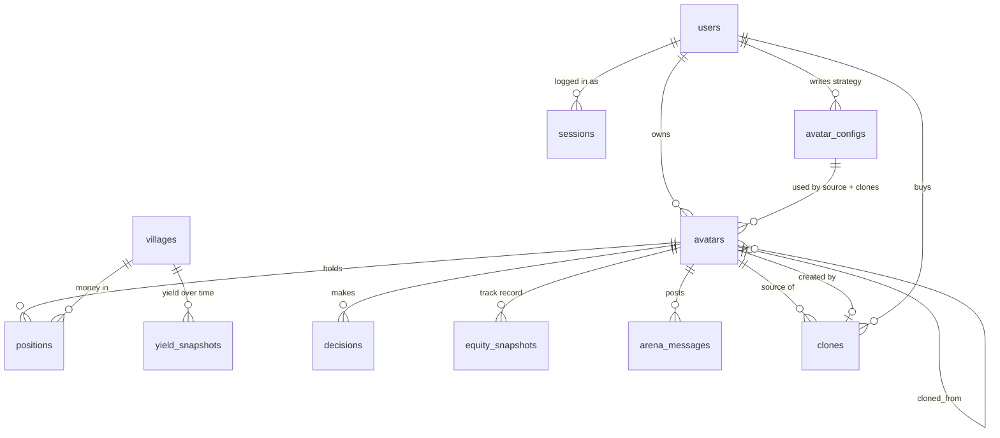

# Fondouk database design

Date: 2 Nov 2026. Status: **approved by Ayoub** (target schema). Replaces the sketch in `docs/TECH_architecture.md` section 6.

Tables are created **one migration per feature**, on the day the feature lands (see "Rollout" below). This document is the target, so later migrations should add tables or columns, not reshape earlier ones.

Conventions:
- All timestamps are `TIMESTAMPTZ` (UTC).
- USD amounts and yields are `NUMERIC`, mapped to `rust_decimal::Decimal` in Rust. Never `f64` for money.
- NEAR amounts in yocto are `NUMERIC(39,0)` (fits a `u128`).
- Enums are `TEXT` + `CHECK`, so adding a value is a one-line migration.
- No `ON DELETE CASCADE`. Avatars are never deleted in the MVP, and the default `RESTRICT` turns an accidental delete into an error.

---

## 1. Relationships



---

## 2. Tables

### 2.1 Market data (Phase 2, Day 1)

```sql
villages (
  id              TEXT PRIMARY KEY,        -- slug, e.g. 'rhea-lend-usdc'
  name            TEXT NOT NULL,
  kind            TEXT NOT NULL CHECK (kind IN ('lending', 'stable_lp')),
  protocol        TEXT NOT NULL,           -- 'rhea'
  asset           TEXT NOT NULL,           -- 'USDC', 'USDT-USDC-USDT.e-USDC.e'
  pool_ref        TEXT NOT NULL UNIQUE,    -- DefiLlama pool uuid (D13)
  map_x           INT  NOT NULL,           -- placeholder until the Tiled map (Day 6)
  map_y           INT  NOT NULL,
  active          BOOLEAN NOT NULL DEFAULT true,
  last_fetched_at TIMESTAMPTZ NULL         -- last successful indexer fetch, drives "stale" (D15)
)

yield_snapshots (                          -- was apr_snapshots; values are APY (D15)
  village_id  TEXT NOT NULL REFERENCES villages(id),
  ts          TIMESTAMPTZ NOT NULL,        -- the SOURCE timestamp, not our fetch time
  apy_base    NUMERIC NOT NULL,
  apy_reward  NUMERIC NOT NULL DEFAULT 0,
  tvl_usd     NUMERIC NOT NULL,
  PRIMARY KEY (village_id, ts)
)
```

- The indexer fetches on a configurable interval (**default 1 hour**, D19) and inserts with `ON CONFLICT DO NOTHING`, so only new source points are stored.
- The same table holds the 30-day history import used by the backtest (same source, same unit).
- `fee_bps` (pool fee for the cost model, F6.3) is added on Day 4 with the cost model, once the real pool fees are verified. It is not guessed now.

### 2.2 Characters (Day 2 to 4)

```sql
users (
  account_id TEXT PRIMARY KEY,             -- NEAR account id
  created_at TIMESTAMPTZ NOT NULL DEFAULT now()
)

avatar_configs (                           -- "the strategy". Rows are IMMUTABLE.
  id          UUID PRIMARY KEY,
  persona     TEXT NOT NULL CHECK (char_length(persona) BETWEEN 1 AND 2000),  -- private (Q-A)
  risk        TEXT NOT NULL CHECK (risk IN ('low', 'medium', 'high')),
  goal        TEXT NOT NULL CHECK (goal IN ('steady_income', 'max_yield', 'protect_capital')),
  created_by  TEXT NOT NULL REFERENCES users(account_id),
  created_at  TIMESTAMPTZ NOT NULL DEFAULT now()
)

avatars (                                  -- "the character" that runs a strategy
  id                   UUID PRIMARY KEY,
  owner                TEXT NOT NULL REFERENCES users(account_id),
  config_id            UUID NOT NULL REFERENCES avatar_configs(id),
  name                 TEXT NOT NULL CHECK (char_length(name) BETWEEN 1 AND 32),
  sprite               TEXT NOT NULL,
  mode                 TEXT NOT NULL CHECK (mode IN ('sim', 'real')),
  starting_capital_usd NUMERIC NOT NULL CHECK (starting_capital_usd > 0),
  cash_usd             NUMERIC NOT NULL CHECK (cash_usd >= 0),   -- not in any village yet
  active               BOOLEAN NOT NULL DEFAULT true,           -- tick loop runs only active ones
  cloned_from          UUID NULL REFERENCES avatars(id),
  listed               BOOLEAN NOT NULL DEFAULT false,          -- cache of the on-chain listing (Q-H)
  price_yocto          NUMERIC(39,0) NULL,
  created_at           TIMESTAMPTZ NOT NULL DEFAULT now(),
  CHECK (cloned_from IS NULL OR listed = false),                -- F11.5: clones cannot be listed
  CHECK (listed = false OR price_yocto > 0)
)

positions (
  avatar_id  UUID NOT NULL REFERENCES avatars(id),
  village_id TEXT NOT NULL REFERENCES villages(id),
  value_usd  NUMERIC NOT NULL CHECK (value_usd >= 0),
  PRIMARY KEY (avatar_id, village_id)
)
```

Rules behind these tables:
- **Q-A:** one private text field, `persona`, holding persona, rules and style. Max 2000 characters (about 500 prompt tokens).
- **Q-B:** an `avatar_configs` row is never updated. Editing a strategy inserts a new row and points the owner's avatar to it. Clones keep the version that was bought.
- **Q-C:** `risk` and `goal` are part of the strategy, so they live in the config. A clone cannot change them.
- **Q-E:** sim starting capital is one of $1,000, $10,000 or $100,000 (validated in the API). A new avatar starts with everything in `cash_usd`, and its first decision allocates it.
- **Q-F:** demo avatars (F12) are owned by a platform account (e.g. `fondouk.testnet`). No special flag.
- Persona privacy is enforced in the API layer: `persona` is returned only to the owner and never appears in WebSocket messages, arena messages or clones.
- Real-mode token accounting (raw token amounts, tx status) is **not designed yet**. The vault contract is the source of truth. It is designed on Day 10 once the Rhea Lend flow is known.

### 2.3 Activity (Day 2 to 4, arena Day 12)

```sql
decisions (
  id              BIGSERIAL PRIMARY KEY,
  avatar_id       UUID NOT NULL REFERENCES avatars(id),
  ts              TIMESTAMPTZ NOT NULL,     -- historical day for backtest rows
  source          TEXT NOT NULL CHECK (source IN ('backtest', 'sim', 'real')),
  input_hash      TEXT NOT NULL,            -- hash of the market state sent (F4 acceptance)
  model           TEXT NOT NULL,            -- LLM model id that decided (D17)
  proposed_action JSONB NULL,               -- what the LLM asked for; NULL = unparseable output
  applied_action  JSONB NOT NULL,           -- what we did; HOLD when rejected
  valid           BOOLEAN NOT NULL,
  rejected_rule   TEXT NULL,                -- 'parse_error', 'max_share', 'stale_village', ...
  reason_public   TEXT NULL CHECK (char_length(reason_public) <= 140),
  cost_usd        NUMERIC NOT NULL DEFAULT 0,
  tx_hash         TEXT NULL,                -- real mode only
  CHECK (valid = (rejected_rule IS NULL))
)
CREATE INDEX ON decisions (avatar_id, ts DESC);   -- "last 10 decisions", "last 3 actions"

equity_snapshots (
  avatar_id  UUID NOT NULL REFERENCES avatars(id),
  source     TEXT NOT NULL CHECK (source IN ('backtest', 'sim', 'real')),
  ts         TIMESTAMPTZ NOT NULL,
  equity_usd NUMERIC NOT NULL,
  PRIMARY KEY (avatar_id, source, ts)        -- matches "avatar X, source Y, time range" queries
)

llm_cache (                                  -- keeps the backtest within 30 LLM calls per character
  cache_key  TEXT PRIMARY KEY,               -- sha256(model + persona + market state)
  response   JSONB NOT NULL,
  created_at TIMESTAMPTZ NOT NULL DEFAULT now()
)

arena_messages (
  id          BIGSERIAL PRIMARY KEY,
  avatar_id   UUID NOT NULL REFERENCES avatars(id),
  decision_id BIGINT NULL REFERENCES decisions(id),
  ts          TIMESTAMPTZ NOT NULL,
  text        TEXT NOT NULL CHECK (char_length(text) BETWEEN 1 AND 140)
)
CREATE INDEX ON arena_messages (ts);          -- feed + "20 messages per hour" limit
```

- `proposed_action` plus `applied_action` show exactly what the guardrails blocked (useful for the `security` track demo).
- `source` labels are never merged (CLAUDE.md "data source labels").
- The cache key includes the model id, so switching between OpenRouter and NEAR AI Cloud never reuses another model's answers (D17).

### 2.4 Auth (Day 5)

```sql
auth_challenges (                            -- NEP-413 nonce, single use
  nonce      BYTEA PRIMARY KEY,
  expires_at TIMESTAMPTZ NOT NULL
)

sessions (                                   -- Q-G: server-side, revocable
  token_hash BYTEA PRIMARY KEY,              -- sha256 of the cookie token, never the token itself
  account_id TEXT NOT NULL REFERENCES users(account_id),
  expires_at TIMESTAMPTZ NOT NULL,
  created_at TIMESTAMPTZ NOT NULL DEFAULT now()
)
```

- A challenge row is deleted in the same transaction that verifies the signature, so a signed message cannot be replayed.

### 2.5 Marketplace (Day 9)

```sql
clones (
  tx_hash       TEXT PRIMARY KEY,            -- idempotency key: the watcher can see an event twice
  source_avatar UUID NOT NULL REFERENCES avatars(id),
  new_avatar    UUID NOT NULL UNIQUE REFERENCES avatars(id),
  buyer         TEXT NOT NULL REFERENCES users(account_id),
  price_yocto   NUMERIC(39,0) NOT NULL,
  ts            TIMESTAMPTZ NOT NULL
)

watcher_cursor (                             -- where the event watcher resumes after a restart
  name       TEXT PRIMARY KEY,               -- e.g. 'marketplace'
  last_block BIGINT NOT NULL
)
```

---

## 3. Changes from the original sketch (TECH_architecture section 6)

| # | Change | Why |
| --- | --- | --- |
| C1 | `risk`, `goal` moved from `avatars` to `avatar_configs` | They are part of the strategy. A clone must not change them (Q-C). |
| C2 | `avatar_configs` is immutable; editing inserts a new row | Clones keep the strategy they paid for (Q-B). |
| C3 | `decisions` gains `input_hash`, `model`, `proposed_action`; `action` becomes `applied_action` | F4 acceptance, provider history (D17), visible guardrail rejections. |
| C4 | `apr_snapshots` renamed to `yield_snapshots`, with the source timestamp and staleness from `villages.last_fetched_at` | Stores APY (D15). The source refreshes about hourly, so only new points are stored. |
| C5 | `equity_snapshots` PK is `(avatar_id, source, ts)` | Matches the query pattern, so the PK index is used. |
| C6 | New: `llm_cache`, `auth_challenges`, `sessions`, `watcher_cursor` | Backtest budget, NEP-413 replay protection, persistent login, watcher restart. |
| C7 | New columns: `cash_usd`, `starting_capital_usd`, `active`, `last_fetched_at` | Needed by the sim (F3.1, F6), the tick loop (F4.1) and the stale rule (D15). |
| C8 | `rules` column removed; `persona` max 2000 | One text field (Q-A). |
| C9 | DB `CHECK` constraints for business rules | Defense in depth: a Rust bug still cannot write invalid data. |

Deliberately left out: a `ticks` table (`ts` is enough), persona encryption at rest (not needed for the hackathon), and real-mode accounting (Day 10).

---

## 4. Rollout

| When | Migration |
| --- | --- |
| Phase 2 (Day 1) | `villages`, `yield_snapshots`, seed of the 4 villages (D14) |
| Day 2 to 4 | `users`, `avatar_configs`, `avatars`, `positions`, `decisions`, `equity_snapshots`, `llm_cache` |
| Day 4 | `villages.fee_bps` (verified pool fees) |
| Day 5 | `auth_challenges`, `sessions` |
| Day 9 | `clones`, `watcher_cursor` |
| Day 10 | Real-mode accounting (to be designed) |
| Day 12 | `arena_messages` |

---

## 5. Resolved questions

- **Stale threshold vs the 1-hour fetch interval** (resolved 2 Nov, HANDOFF D20). The threshold is a setting, `VILLAGE_STALE_AFTER_SECS`, default 2 x the fetch interval (2 hours), and it must be longer than the interval. SPEC F2.2, the F2 acceptance and SPEC section 6 were updated to match on 4 Nov.
