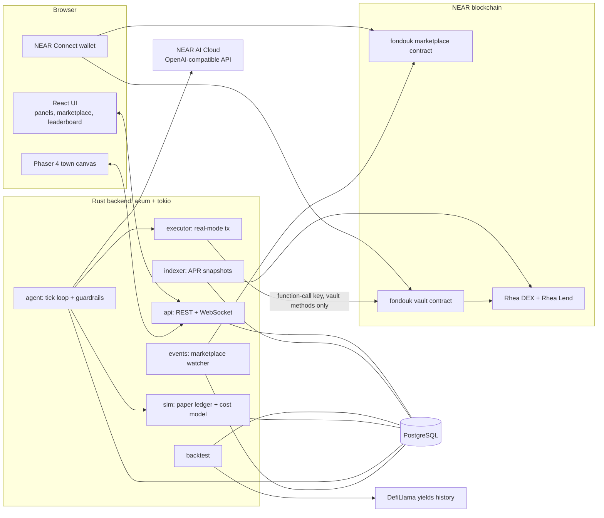

# Fondouk: Technical Architecture

Version 0.1, 23 Oct 2026. Read `SPEC.md` first for what we build. This file is about how.

---

## 1. Principles

1. **Modular monolith.** One Rust backend binary with clear modules. No microservices. Faster to build and debug in 14 days.
2. **The LLM proposes, code decides.** The model only picks from a fixed action set. All limits are checked in Rust, and again on-chain for real funds.
3. **Contracts are small.** Two contracts, each with one job. Less code means fewer bugs in the place where bugs cost money.
4. **Everything is labeled.** Backtest, simulated and real data are stored and shown separately.
5. **Secrets never in the repo.** Keys only in environment variables.

---

## 2. System diagram



---

## 3. Tech stack

Versions below were checked on 23 Oct 2026. "Latest found" means the newest version seen in public sources that day. Run `cargo add` or `npm install` and use what resolves, then pin it in the lockfile.

### Frontend

| Part | Choice | Version | Status | Why |
| --- | --- | --- | --- | --- |
| Game engine | Phaser 4 | 4.2.1 (9 Jul 2026) | Latest found | Built-in tilemaps, sprite animation, camera, Tiled support. PixiJS is only a renderer and would need more custom code. |
| Map editor | Tiled | n/a | Not checked | Standard map editor that Phaser loads directly. |
| App shell | React + TypeScript + Vite | not checked | **Verify on setup** | Panels, forms, tables are normal UI, easier in React than in Phaser. |
| Wallet | `@hot-labs/near-connect` + `near-connect-hooks` | not checked | **Verify on setup** | Current NEAR docs recommend NEAR Connect over the older Wallet Selector. |
| Charts | Any small chart lib (decide on setup) | n/a | Open | Equity and APR sparklines. |
| Art | Free pixel tilesets and sprites | n/a | Check each license | Must allow public use. |

### Backend (Rust)

| Part | Choice | Version | Status | Why |
| --- | --- | --- | --- | --- |
| HTTP + WebSocket | axum | 0.8.9 | Latest found | Stable, tokio-native, built-in WebSocket support. |
| Runtime | tokio | not checked | Verify on setup | Standard async runtime. |
| Database access | sqlx + PostgreSQL | not checked | Verify on setup | Compile-time checked SQL, team knows Postgres. |
| NEAR client | near-api | 0.8.3 | Latest found | Official Rust client: view calls, signing, transactions. |
| LLM client | async-openai | 0.43.0 | Latest found (2 Nov) | Plain OpenAI-compatible client, no agent framework. Point `OpenAIConfig` at the NEAR AI Cloud base URL. Chosen by Ayoub on 2 Nov instead of rig. |
| LLM provider | NEAR AI Cloud (demo), OpenRouter (dev) | n/a | Verified API shape | Chosen by env (D17). NEAR AI Cloud: OpenAI-compatible at `https://cloud-api.near.ai/v1`, TEE-based private inference, model list at `https://cloud-api.near.ai/v1/model/list`. OpenRouter: `https://openrouter.ai/api/v1`, `json_schema` output only on some models. |
| Serialization | serde, serde_json | not checked | Verify | Standard. |
| Logging | tracing | not checked | Verify | Structured logs for every decision. |

### Smart contracts (Rust)

| Part | Choice | Version | Status | Why |
| --- | --- | --- | --- | --- |
| Contract SDK | near-sdk-rs | **Unconfirmed** | Verify with `cargo add near-sdk` | NEAR's Jan 2026 devtools update said v6.x was being prepared. Use the latest stable that resolves. |
| Build and deploy | cargo-near | **Unconfirmed** | Verify | In maintenance mode per the same update, still the standard tool. |
| Local tests | near-sandbox (with near-api) | **Unconfirmed** | Verify | near-workspaces-rs is being deprecated in favor of near-api-rs + near-sandbox-rs. |
| Event format | NEP-297 events | n/a | Standard | Backend indexes marketplace events. |
| Token standard | NEP-141 (fungible tokens) | n/a | Standard | Stablecoin deposits into the vault. |

### Data sources

| Source | Use | Status |
| --- | --- | --- |
| Rhea contracts (view calls) | Optional later: fresher lending APR via `contract.main.burrow.near` `get_asset` | Verified 2 Nov (HANDOFF U4). Not used by the indexer for MVP (decision D13). |
| DefiLlama yields (`yields.llama.fi/pools`, `yields.llama.fi/chart/{pool}`) | Live snapshots **and** 30-day history for backtest (D13) | Free, no key (verified 2 Nov). Values are APY. Refreshed about hourly. |
| Own snapshots | Fallback history | Start recording before 1 Nov if possible, so we own a few weeks of data. |

### Hosting

| Part | Choice |
| --- | --- |
| Frontend | Vercel (static build) |
| Backend + Postgres | One small VPS or Railway. Single binary + Postgres. |
| Contracts | Marketplace on testnet. Vault on mainnet with tiny caps if Rhea has no testnet (open question Q2). |

---

## 4. Repository layout

```
fondouk/
  README.md                 # for humans and AI judges: what, why, "do X, see Y"
  overview.md
  SPEC.md
  TECH_architecture.md
  HANDOFF.md
  contracts/
    marketplace/            # near-sdk, listing + clone payment + events
    vault/                  # near-sdk, per-avatar accounting + operator actions
  backend/
    Cargo.toml
    migrations/             # sqlx migrations
    src/
      main.rs
      config.rs
      db/                   # queries, models
      indexer/              # Rhea APR snapshots
      backtest/
      sim/                  # paper ledger + cost model
      agent/                # tick loop, prompt builder, schema, guardrails
      executor/             # real-mode transactions via vault
      events/               # marketplace event watcher
      api/                  # REST + WebSocket handlers
  frontend/
    src/
      game/                 # Phaser scenes, sprites, map loading
      ui/                   # React panels, forms, leaderboard, marketplace
      lib/                  # api client, wallet
    public/assets/          # tilesets, sprites, Tiled map json
  scripts/                  # data checks, seeding, deploy helpers
```

---

## 5. Backend modules

### 5.1 indexer
- On a configurable interval (default 1 hour, D19): for each village, fetch the latest point from DefiLlama `/chart/{pool_ref}` (base APY, reward APY, TVL) and insert it into `yield_snapshots` only if its source timestamp is new (D13). Then set `villages.last_fetched_at`.
- Mark a village stale if the indexer has not fetched it successfully for 30 minutes (D15). The source itself refreshes about hourly, so the source timestamp is not used for staleness.
- Broadcast new APRs over WebSocket.

### 5.2 backtest
- Input: character config, list of villages, 30 days of history.
- For each day: build market state from history, call the same `decide()` function as live, apply guardrails, apply the cost model, accrue yield for one day.
- Output: 30 rows in `equity_snapshots` with `source = 'backtest'`.
- LLM budget: max 30 calls per character. Cache by (persona hash, market state hash).

### 5.3 sim
- Ledger in USD terms. Positions per village.
- Accrual per tick: `value += value * apr/100 * tick_seconds/31_536_000`.
- Cost model per move: `pool_fee + slippage(size, tvl) + gas_usd`. Slippage starts as a simple function, for example `size / tvl * k` with `k` tuned so small moves cost little.

### 5.4 agent
- Tick scheduler (tokio interval, default 10 minutes).
- For each active character, in parallel with a concurrency limit (for example 8):
  1. Build market state (JSON): villages with APR, 24h change, stale flag, own positions, last 3 own actions.
  2. Build prompt: system rules + persona (private) + market state + action JSON schema.
  3. Call LLM with temperature 0 to 0.2, max tokens small.
  4. Parse JSON. On parse failure, retry once, then `HOLD`.
  5. Run guardrails (`SPEC.md` section 6). On violation, `HOLD` and log the rule.
  6. Apply: sim ledger, or send to executor for real mode.
  7. Log a row in `decisions`, broadcast over WebSocket.
- `decide()` is a pure function boundary (market state + config in, action out) so backtest and live share it.

### 5.5 executor (real mode)
- Holds only a **function-call access key** for the vault contract, limited to the operator methods (`agent_supply`, `agent_withdraw`). This key cannot transfer NEAR and cannot call any other contract.
- Sends the call, waits for the result, stores tx hash in `decisions`.

### 5.6 events
- Polls the marketplace contract for new `clone_purchased` events (or reads recent receipts via RPC).
- Creates the clone row in the database. Idempotent by tx hash.

### 5.7 api
REST:
- `GET /villages`, `GET /villages/:id/history`
- `GET /avatars`, `GET /avatars/:id`, `GET /avatars/:id/decisions`, `GET /avatars/:id/equity`
- `POST /avatars` (create, runs backtest), `PATCH /avatars/:id` (owner only)
- `GET /leaderboard?window=7d|30d&tab=main|new`
- `GET /arena/feed`
- `POST /auth/near` (verify signed message, start session)

WebSocket `/ws` messages: `apr_update`, `decision`, `avatar_move`, `arena_message`, `clone_created`.

The persona field is only returned to the owner, and never inside WebSocket messages.

---

## 6. Data model (PostgreSQL)

**The full, approved design lives in [`dev-docs/2026-11-02/database-design.md`](../dev-docs/2026-11-02/database-design.md)** (columns, constraints, indexes, rules and rollout per day). Summary:

```sql
-- market data
villages         (id TEXT PK, name, kind, protocol, asset, pool_ref UNIQUE, map_x, map_y, active, last_fetched_at)
yield_snapshots  (village_id FK, ts, apy_base, apy_reward, tvl_usd, PRIMARY KEY (village_id, ts))
-- characters
users            (account_id TEXT PK, created_at)
avatar_configs   (id UUID PK, persona TEXT <= 2000, risk, goal, created_by FK users, created_at)  -- immutable
avatars          (id UUID PK, owner FK users, config_id FK, name, sprite, mode, starting_capital_usd,
                  cash_usd, active, cloned_from NULL, listed, price_yocto NULL, created_at)
positions        (avatar_id FK, village_id FK, value_usd, PRIMARY KEY (avatar_id, village_id))
-- activity
decisions        (id BIGSERIAL PK, avatar_id FK, ts, source, input_hash, model, proposed_action JSONB NULL,
                  applied_action JSONB, valid, rejected_rule NULL, reason_public, cost_usd, tx_hash NULL)
equity_snapshots (avatar_id FK, source, ts, equity_usd, PRIMARY KEY (avatar_id, source, ts))
llm_cache        (cache_key TEXT PK, response JSONB, created_at)
arena_messages   (id BIGSERIAL PK, avatar_id FK, decision_id FK NULL, ts, text)
-- auth
auth_challenges  (nonce BYTEA PK, expires_at)
sessions         (token_hash BYTEA PK, account_id FK users, expires_at, created_at)
-- marketplace
clones           (tx_hash TEXT PK, source_avatar FK, new_avatar FK UNIQUE, buyer FK users, price_yocto, ts)
watcher_cursor   (name TEXT PK, last_block BIGINT)
```

---

## 7. Smart contracts

### 7.1 Marketplace contract

State:
- `listings: LookupMap<AvatarId, Listing { creator: AccountId, price: NearToken, active: bool }>`
- `platform_account: AccountId`, `platform_fee_bps: u16` (default 1000 = 10%)
- `owner: AccountId` (admin)

Methods:
- `list(avatar_id: String, price: NearToken)`: caller becomes creator. Backend must confirm the caller owns the avatar and it is not a clone. Simplest MVP: backend calls an admin method `approve_listing(avatar_id, creator)` first, then creator calls `list`.
- `unlist(avatar_id)`: creator only.
- `buy_clone(avatar_id)` `#[payable]`: requires attached deposit == price. Transfers `price * (1 - fee)` to creator and the fee to platform. Emits NEP-297 event `clone_purchased { avatar_id, buyer, creator, price }`.
- View: `get_listing(avatar_id)`, `get_listings(from, limit)`.

Tests: wrong deposit fails, unlisted fails, split is exact (no rounding loss: give remainder to creator), event emitted.

### 7.2 Vault contract

Purpose: hold real funds per character, let the AI operator move them only between whitelisted pools, let only the owner withdraw.

State:
- `balances: LookupMap<(AvatarId, TokenId), u128>` (idle in vault)
- `supplied: LookupMap<(AvatarId, TokenId), u128>` (accounted as supplied to Rhea Lend)
- `avatar_owner: LookupMap<AvatarId, AccountId>`
- `operator: AccountId`
- `whitelist: target pools / tokens`
- `limits: { max_deposit_per_avatar, max_per_action, cooldown_ns }`
- `last_action_ns: LookupMap<AvatarId, u64>`

Methods:
- `ft_on_transfer(sender_id, amount, msg)`: deposit. `msg` contains the `avatar_id`. Rejects unknown tokens and deposits above the cap (returns the unused amount).
- `register_avatar(avatar_id, owner)`: operator only.
- `withdraw(avatar_id, token, amount)` `#[payable]` with exactly 1 yoctoNEAR: owner only, sends from idle balance to owner.
- `agent_supply(avatar_id, token, amount)`: operator only, **non-payable**, checks whitelist, cap and cooldown, then the vault calls the token's `ft_transfer_call` to Rhea Lend, attaching 1 yoctoNEAR from the vault's own balance, with a callback that updates accounting only on success.
- `agent_withdraw(avatar_id, token, amount)`: operator only, non-payable, calls Rhea Lend to withdraw back to the vault, callback updates accounting.
- Views: `get_avatar(avatar_id)`.

**Why this design:** NEAR function-call access keys cannot attach any deposit, and NEP-141 `ft_transfer_call` needs exactly 1 yoctoNEAR. So the backend cannot call Rhea directly with a limited key. Instead the backend's limited key calls the vault's non-payable operator methods, and the vault itself attaches the 1 yoctoNEAR. Result: a stolen operator key can only move funds between whitelisted pools inside the caps, never out to another account. Withdrawal to the owner needs the owner's wallet.

**Unknowns (see SPEC Q2, Q3):** exact Rhea Lend contract id and the method flow for supply and withdraw (it may need an `execute` call with actions, and some actions may require oracle prices). Read the Rhea docs and source before writing this. If it is too complex by day 9, real mode ships as deposit, hold, withdraw only.

**Security checklist:**
- Callbacks are `#[private]` and handle failure (refund accounting, never assume success).
- No state change before the cross-contract call that cannot be rolled back in the callback.
- Owner checks on every user method. Operator checks on every agent method.
- Caps enforced in the contract, not only in the backend.
- Unit tests plus sandbox tests for: deposit over cap, withdraw by non-owner, operator trying to send to non-whitelisted target, callback failure.

---

## 8. Frontend

- Phaser scene loads the Tiled map JSON, places villages from `/villages` (map_x, map_y), spawns sprites from `/avatars`.
- Sprite target position = village with the largest share of that avatar's funds. On `avatar_move` message, the sprite walks there (simple path along the road tiles is enough, no full pathfinding needed).
- React overlays: header with wallet, side panel (avatar or village details), leaderboard page, marketplace page, create-avatar modal, judge tour.
- Phaser and React talk through a small event bus (`emit('avatar:selected', id)`).

---

## 9. Testing

| Layer | What | Tool |
| --- | --- | --- |
| Contracts | Unit tests + sandbox integration tests | cargo test, near-sandbox |
| Guardrails | Table tests for every rule in SPEC section 6 | cargo test |
| Sim + cost model | Accrual math, cost math, "moving often costs more" test | cargo test |
| Agent | Mock LLM returns valid, invalid and broken JSON, check outcomes | cargo test |
| Persona leak | Arena messages vs persona, no 8-word overlap | cargo test |
| End-to-end | Create avatar, run 3 ticks, check decisions and equity rows | script against local backend |

---

## 10. Risks

| Risk | Impact | Likelihood | Plan |
| --- | --- | --- | --- |
| Rhea Lend integration from a contract is complex | Real mode weak | High | Spike on day 3. Fallback: vault deposit and withdraw only. |
| No free history data | Backtest weak | Medium | Record own snapshots now. Fallback: backtest with fewer days. |
| LLM returns bad JSON or random decisions | Messy demo | Medium | Low temperature, schema, retry once, then HOLD. |
| async-openai custom base URL does not work with NEAR AI Cloud | Delay | Low | Use reqwest directly with the OpenAI chat format. |
| Scope too big for solo | Unfinished demo | High | P0 first. Social arena and real mode are P1. |
| Map and art take too long | Ugly demo | Medium | Use one free tileset, simple sprites, no custom art. |
